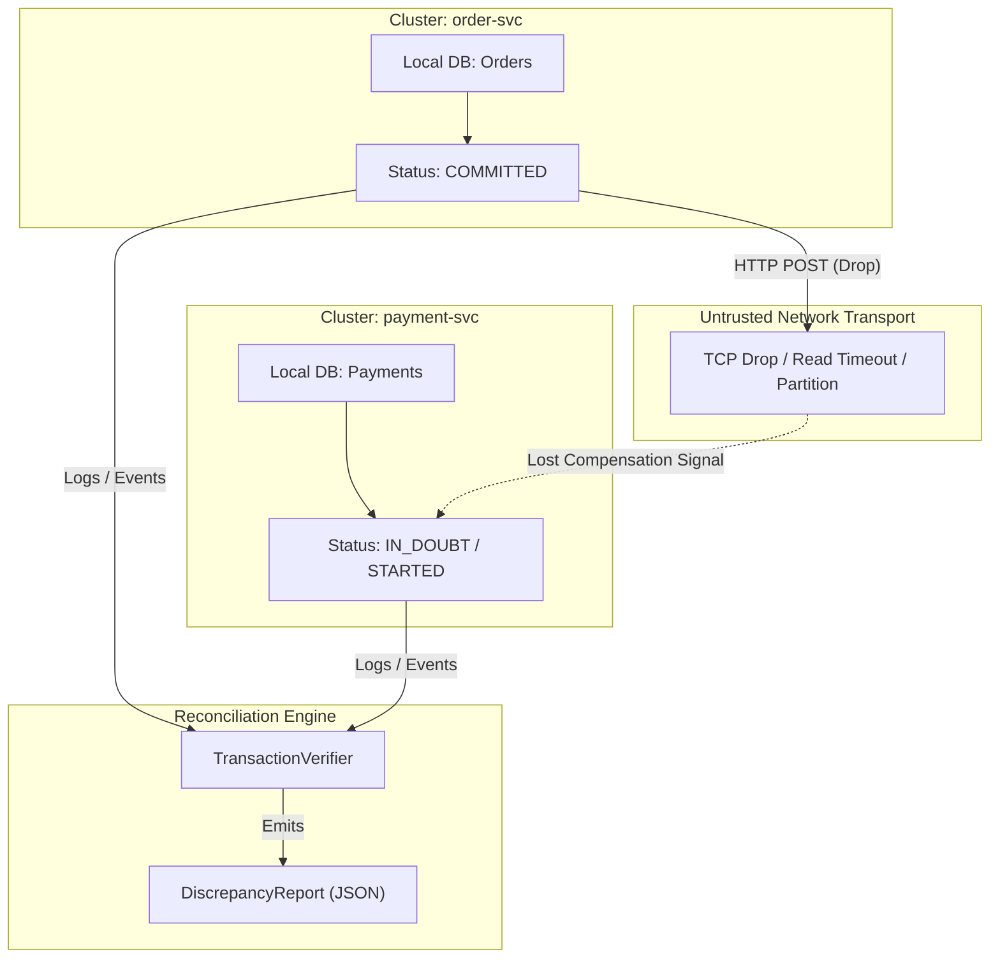

> 本文为原文前 6,000 字符的节选翻译，完整内容请查看原文。

### Unmasking the Silent Failures of Distributed Transactions: Detecting In-Doubt States and Validating Compensations with Python

在微服务架构中，显性错误往往不是最危险的故障。HTTP 500 状态码、未捕获的异常或失败的 gRPC 断言会在访问日志中留下痕迹，增加错误率指标，触发警报，并唤醒值班工程师。真正的运维噩梦是静默的数据不一致——即没有抛出未处理的异常，但分布式状态却因部分网络超时、孤立的分布式状态或丢失的补偿命令而逐渐偏离同步。本文剖析了网络超时如何导致事务跨服务边界进入“存疑（In-Doubt）”状态，研究了补偿事务失败的机制，并详细介绍了一个使用 Python、Pydantic 和 orjson 实现的端到端对账工具，用于检测和审计跨服务差异。

### 1. Failure Anatomy: How Timeouts Create Distributed In-Doubt States

考虑一个涉及 order-svc（订单服务）和 payment-svc（支付服务）的多阶段结账流程。在缺乏集中式两阶段提交（2PC）协调器的典型解耦架构中，服务依赖于编排或基于编排的 Saga 模式。

**序列图：**
```mermaid
sequenceDiagram
    autonumber
    participant Client as "API Gateway / Client"
    participant Order as "order-svc (RDB)"
    participant Payment as "payment-svc (RDB)"
    Client -- "POST /orders/checkout" --> Order
    Note over Order: Step 1: Commit local transaction (COMMITTED)
    Order -- "POST /payments/charge" --> Payment
    Note over Payment: Network Timeout / Dropped TCP Packet
    Order -. "HTTP Timeout Exception" .-> Order
    Note over Order: Attempt Compensating Rollback
    Order -- "POST /payments/compensate (Lost)" --> Payment
    Note over Payment: Processing continues or state hangs (IN_DOUBT)
```

**分区剖析：**
第一步：order-svc 持久化并提交本地订单记录，状态为 COMMITTED。
第二步：order-svc 向 payment-svc 发送同步扣款请求。
第三步（网络故障）：在 payment-svc 接受或开始事务后连接中断，或者反向代理在标准的 5,000ms 阈值后超时。
第四步：order-svc 捕获套接字超时（ReadTimeoutError）并发出回滚或补偿调用。
第五步：由于分区或路由失败，补偿指令丢失或被拒绝。order-svc 标记错误，但 payment-svc 仍处于不确定的 STARTED 或 IN_DOUBT 状态。

在此关头，标准的应用性能监控（APM）工具通常会记录不同的追踪信息。在事后分类期间，手动跨数千兆字节的结构化日志追踪跨服务的单个跨度（使用 correlation_id / X-Trace-Id）不仅容易出错、耗费人力，而且无法扩展。

### 2. Technical Architecture of Cross-Service Inconsistency

为了理解对账机制的工作原理，我们必须将跨独立持久化存储的事务状态生命周期形式化。

**流程图：**


在评估跨节点事务时：
一致性提交：order-svc 和 payment-svc 均达到 COMMITTED。
一致性中止：order-svc 为 ROLLED_BACK，payment-svc 也为 ROLLED_BACK。
发散性不一致（存疑）：一个服务记录为 COMMITTED，而下游服务记录为 IN_DOUBT、STARTED，或缺少补偿记录。

### 3. Designing a Fast, Type-Safe Verification Engine

构建对账扫描器需要解决三个实际的分布式日志记录约束：
时间戳漂移与格式不一致：节点输出的时间戳通常具有不一致的 UTC 指定（Z 与 +00:00 或原生时间戳）。
数据吞吐量：日志聚合流会产生数百万行数据。标准的 Python json.loads 开销会成为瓶颈；必须使用 orjson 进行快速序列化。
模式验证：格式错误的 JSON 行或不完整的日志条目不得中断处理循环。

### Complete Python Implementation

以下工具处理多服务日志条目，按事务标识符（correlation_id）对状态进行分组，验证 ISO 8601 时间戳，并识别陷入不完整或不确定状态的事务。

```python
import orjson
import logging
import sys
from pydantic import BaseModel, Field, field_validator, ValidationError
from typing import List, Dict, Literal
from datetime import datetime

# Configure structured logging
logging.basicConfig(level=logging.INFO, format="%(levelname)s: %(message)s")
logger = logging.getLogger(__name__)

class TransactionLog(BaseModel):
    """ 
    Represents an atomic log entry emitted by a microservice participating in a distributed transaction. 
    """
    correlation_id: str
    service_name: str
    status: Literal["STARTED", "COMMITTED", "ROLLED_BACK", "IN_DOUBT"]
    timestamp: datetime

    @field_validator("timestamp", mode="before")
    def parse_timestamp(cls, v: object) -> object:
        """ 
        Normalizes ISO 8601 representations across different language runtimes 
        (e.g., standardizing 'Z' to explicit UTC offset '+00:00'). 
        """
        if isinstance(v, str):
            v = v.replace("Z", "+00:00")
        return datetime.fromisoformat(v)
    return v

class DiscrepancyReport(BaseModel):
    """ 
    Structured discrepancy report generated for inconsistent distributed transactions. 
    """
    correlation_id: str
    inconsistent_services: List[str]
    description: str
```